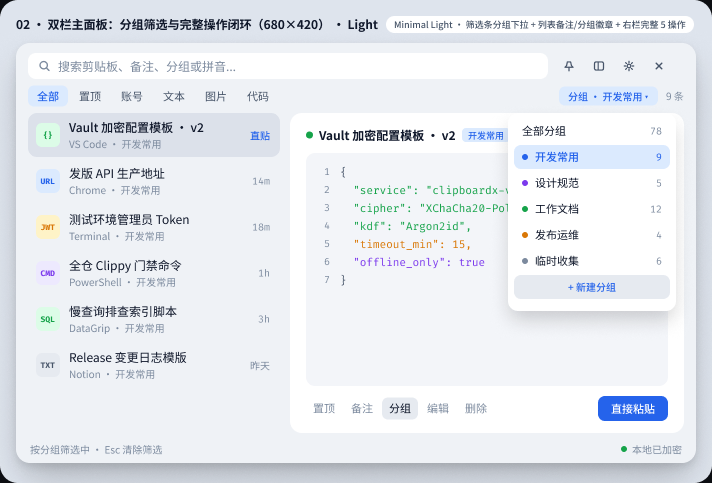
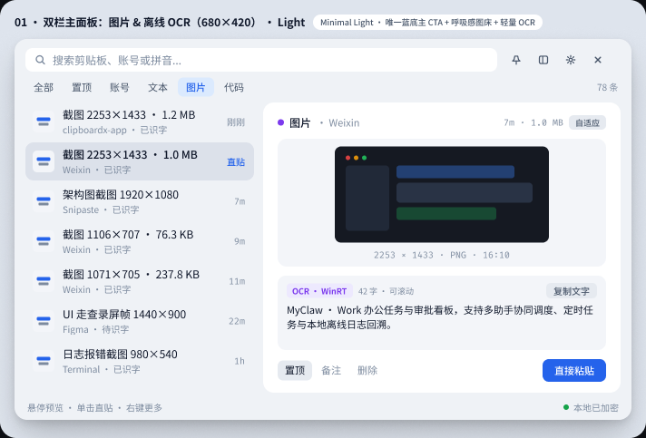
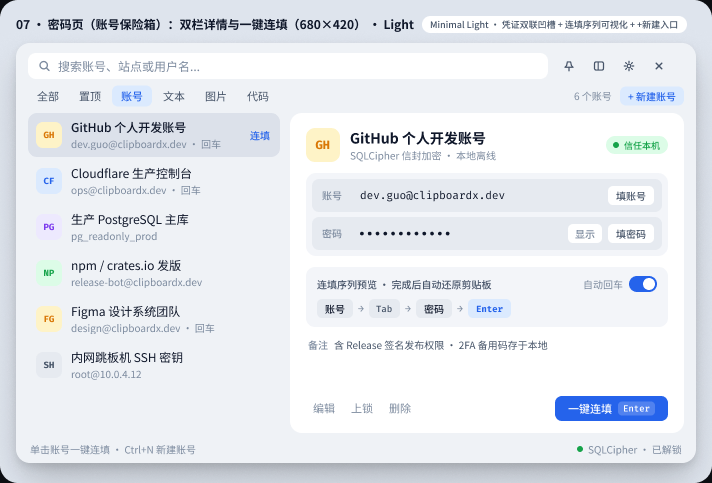
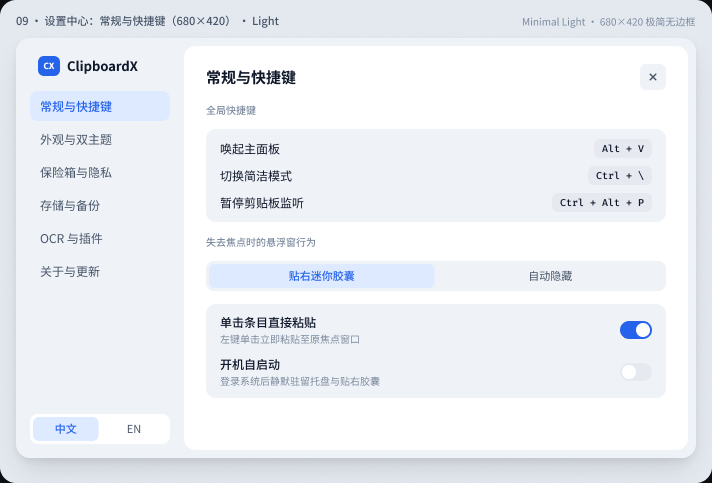
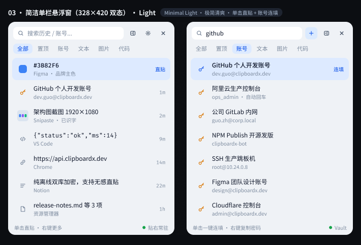
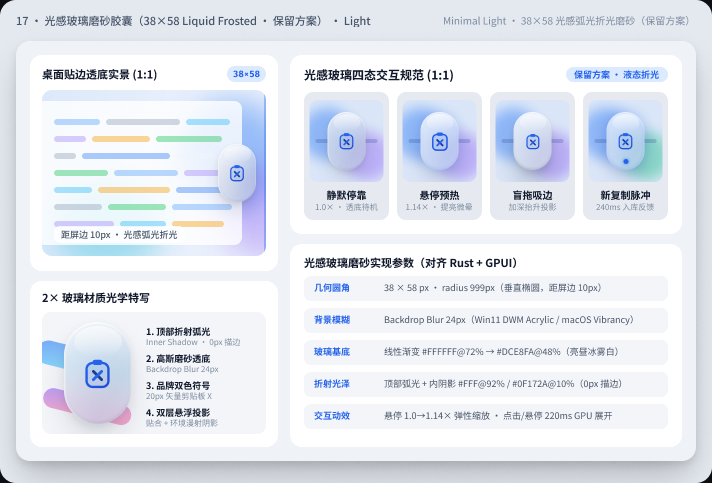

# ClipboardX

English | [简体中文](README.zh-CN.md)

A fast, offline-first, cross-platform clipboard manager and encrypted credential vault built with **Rust** and **GPUI**.

---

## Preview

| Dual-Pane (Main) | Dual-Pane (Image & OCR) |
| :---: | :---: |
|  |  |

| Account Vault | Settings Center |
| :---: | :---: |
|  |  |

| Compact Floating Panel | Liquid Glass Capsule |
| :---: | :---: |
|  |  |

---

## Features

- **Borderless Tonal UI**: Crisp `680×420` dual-pane and `328×420` compact single-pane floating windows with `180ms` smooth collapse, liquid optical glass mini-capsule docking, and built-in Night / Light themes.
- **Full-Stack Local Encryption**: Dual-database isolation (`history.db` + `vault.db`) powered by SQLCipher (including FTS5), OS keyring envelope encryption, and content-addressed `XChaCha20-Poly1305` blob storage.
- **Smart Content Inspection**: Automatic recognition and specialized previews for code snippets, JSON, JWT tokens, colors (with WCAG contrast & OKLCH), URLs (with tracking-parameter stripping), Unix timestamps, and images.
- **Multi-Dimensional Search**: Instant filtering across FTS5 full-text search, Chinese Pinyin (initials & full), fuzzy matching, regex (`/pattern/`), and structured prefixes (`type:image`, `app:editor`).
- **Account Vault & Auto-Fill**: Separate passphrase-protected credential vault with strength meter, CSPRNG password generator, and one-click sequential auto-fill that safely restores your previous clipboard.
- **Offline OCR**: Native OS OCR (WinRT / Vision) plus optional on-demand or local-archive plugin support for offline image text indexing.
- **Zero Telemetry**: 100% local execution with optional signed release verification.

---

## Architecture

ClipboardX follows a strict acyclic hexagonal workspace layout:

| Crate | Responsibility |
| :--- | :--- |
| `clipboardx-model` | Single source of truth for domain models, themes, layouts, shortcuts, config schema, and port traits |
| `clipboardx-core` | Business logic, content inspector, search engine, deduplication, and `.cbx` encrypted archive export/import |
| `clipboardx-storage` | SQLCipher dual-DB persistence, `XChaCha20-Poly1305` CAS blobs, thumbnails, and OS keyring integration |
| `clipboardx-platform` | Cross-platform clipboard watcher, privacy gate, dual-mode hotkey state machine, tray icon, and auto-fill |
| `clipboardx-ocr` | Native OS OCR providers and isolated child-process OCR plugin manager |
| `clipboardx-updater` | Optional Ed25519-signed and SHA-256-verified release updater |
| `clipboardx-app` | GPUI desktop application assembling shell, history, vault, settings, and theme systems |

---

## Build & Run

### Prerequisites

- **Rust** `1.89+` (Edition 2024)
- Platform build tools (Windows MSVC Build Tools / macOS Xcode Command Line Tools / Linux GTK & X11/Wayland dev libraries)

### Commands

```bash
# Run the desktop application
cargo run -p clipboardx-app

# Run all workspace checks, linter, and tests
cargo check --workspace --all-targets
cargo clippy --workspace --all-targets -- -D warnings
cargo test --workspace
```

---

## License

Licensed under the [MIT License](LICENSE-MIT).
