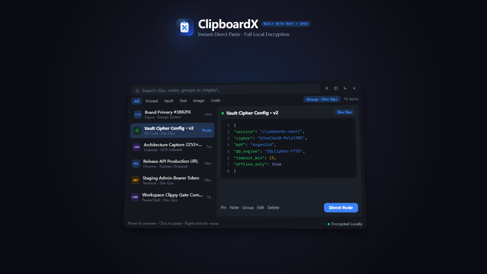
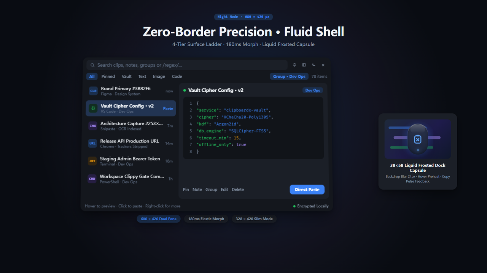
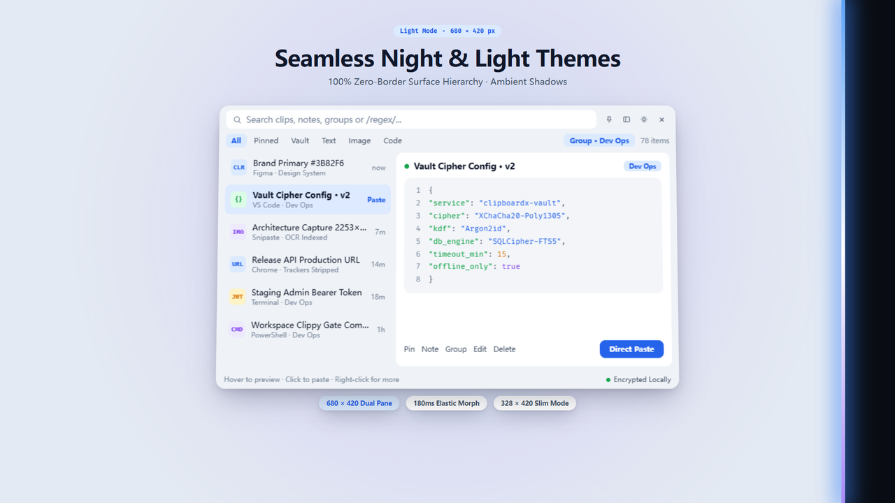
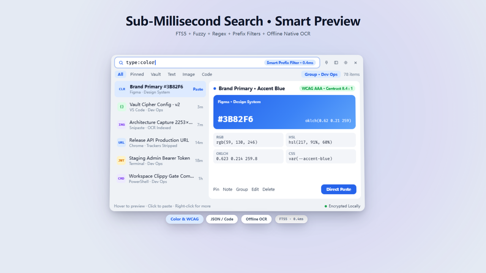

<div align="center">


# ClipboardX

**Offline-first, cross-platform clipboard manager & encrypted credential vault built with Rust + GPUI.**

English | [简体中文](README.zh-CN.md)

[](https://github.com/GXSZone/ClipboardX/releases/latest)
[](LICENSE-MIT)
[](https://www.rust-lang.org/)
[](https://github.com/GXSZone/ClipboardX/releases/latest)

[Download Latest Release](https://github.com/GXSZone/ClipboardX/releases/latest) · [Watch Full 50s Video (with Audio)](https://github.com/GXSZone/ClipboardX/releases/download/v0.1.0/clipboardx-promo-en-preview.mp4)

<br />


</div>

---

## Visual Showcase

| Dual-Pane Main Panel (Night) | Liquid Frosted Dock Capsule |
| :---: | :---: |
|  |  |

| Seamless Night & Light Themes | Instant Search & Smart Color Preview |
| :---: | :---: |
|  |  |

| Image Preview & Offline Native OCR | Encrypted Account Vault & Auto-Fill |
| :---: | :---: |
|  |  |

---

## Core Features

- **Borderless Tonal UI**: Crisp `680×420` dual-pane and `328×420` compact single-pane floating windows with `180ms` elastic morphing, `38×58` liquid optical glass dock capsule, and Night / Light themes with 0px borders.
- **Full-Stack Local Encryption**: Dual-database isolation (`history.db` + `vault.db`) powered by SQLCipher (including FTS5), OS keyring envelope encryption, and content-addressed `XChaCha20-Poly1305` blob storage.
- **Smart Content Inspection**: Automatic recognition and tailored preview cards for code snippets, JSON, JWT tokens, colors (with WCAG contrast & OKLCH), URLs (with tracking-parameter stripping), Unix timestamps, and images.
- **Sub-Millisecond Multi-Dimensional Search**: Instant filtering across FTS5 full-text search, Chinese Pinyin (initials & full), fuzzy matching, regex (`/pattern/`), and structured prefixes (`type:color`, `type:image`, `app:editor`).
- **Account Vault & Auto-Fill**: Separate passphrase-protected credential vault with strength meter, CSPRNG password generator, and one-click sequential auto-fill (`User → Tab → Password → Enter`) that safely restores your original clipboard.
- **Offline OCR**: Native OS OCR (WinRT / Vision) plus optional on-demand or local-archive plugin support that automatically writes extracted screenshot text into the encrypted search index.
- **Zero Telemetry**: 100% offline execution with optional Ed25519-signed release update verification.

---

## Download

Pre-built binaries are available on [GitHub Releases](https://github.com/GXSZone/ClipboardX/releases/latest):

| Platform | Package |
| :--- | :--- |
| **Windows (x86_64)** | `clipboardx-windows-x86_64-setup.exe` (Installer) · `clipboardx-windows-x86_64-portable.zip` (Portable) |
| **macOS (Apple Silicon)** | `clipboardx-macos-aarch64.dmg` · `clipboardx-macos-aarch64.zip` |
| **Linux (x86_64)** | `clipboardx-linux-x86_64.AppImage` · `clipboardx-linux-x86_64.tar.gz` |

---

## Architecture

ClipboardX follows a strict acyclic hexagonal workspace layout:

| Crate | Responsibility |
| :--- | :--- |
| `clipboardx-model` | Single source of truth for domain models, themes, layouts, shortcuts, config schema, and port traits |
| `clipboardx-core` | Business logic, content inspector, search engine, deduplication, and `.cbx` encrypted archive export/import |
| `clipboardx-storage` | SQLCipher dual-DB persistence, `XChaCha20-Poly1305` CAS blobs, thumbnails, and OS keyring integration |
| `clipboardx-platform` | Cross-platform clipboard watcher, privacy gate, dual-mode hotkey state machine, tray icon, and auto-fill |
| `clipboardx-ocr` | Native OS OCR providers and isolated child-process OCR plugin manager |
| `clipboardx-updater` | Optional Ed25519-signed and SHA-256-verified release updater |
| `clipboardx-app` | GPUI desktop application assembling shell, history, vault, settings, and theme systems |

---

## Build & Run

### Prerequisites

- **Rust** `1.89+` (Edition 2024)
- Platform build tools (Windows MSVC Build Tools / macOS Xcode Command Line Tools / Linux GTK & X11/Wayland dev libraries)

### Commands

```bash
# Run the desktop application
cargo run -p clipboardx-app

# Run all workspace checks, linter, and tests
cargo check --workspace --all-targets
cargo clippy --workspace --all-targets -- -D warnings
cargo test --workspace
```

---

## License

Licensed under the [MIT License](LICENSE-MIT).
