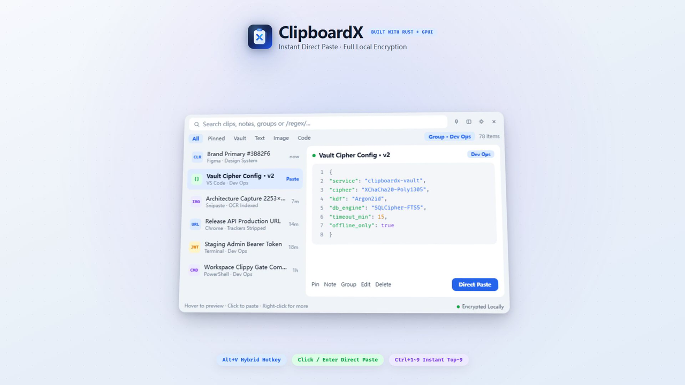
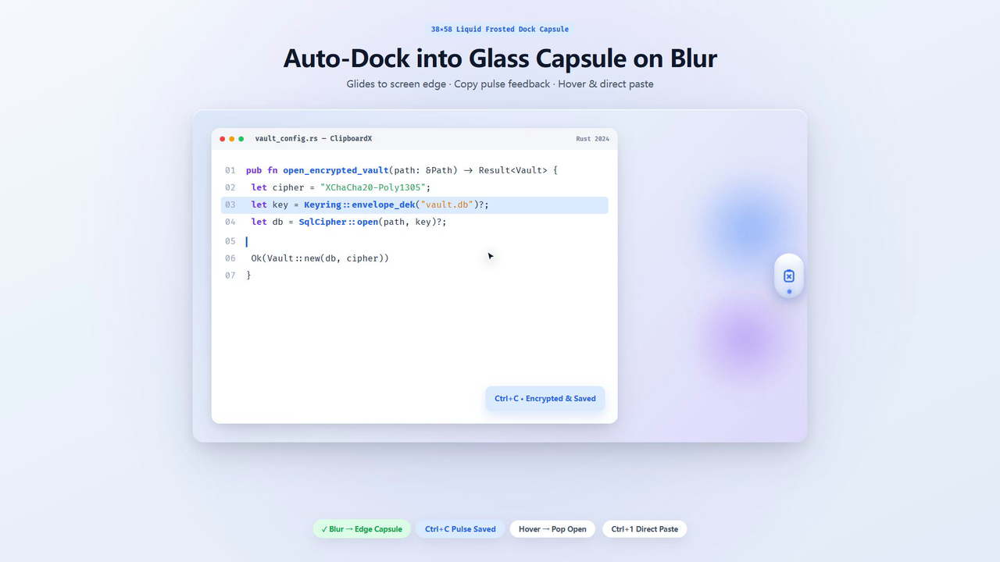
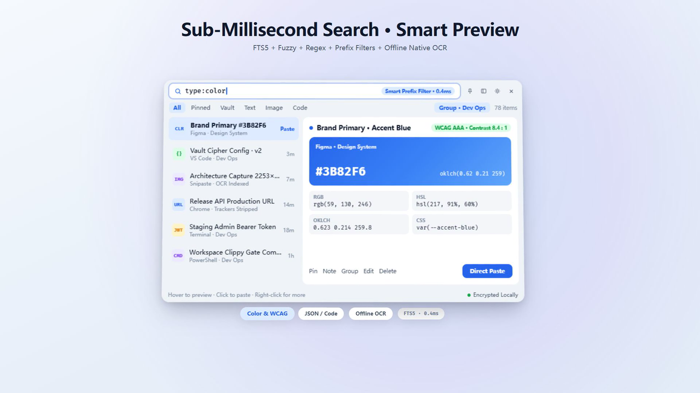
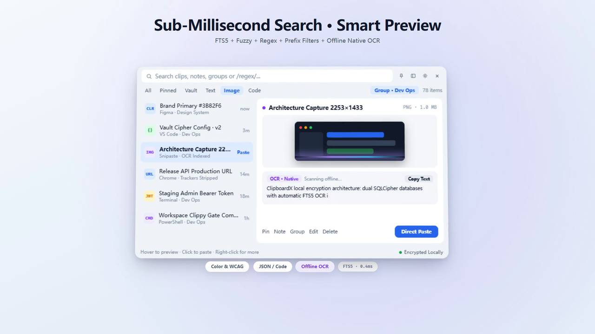
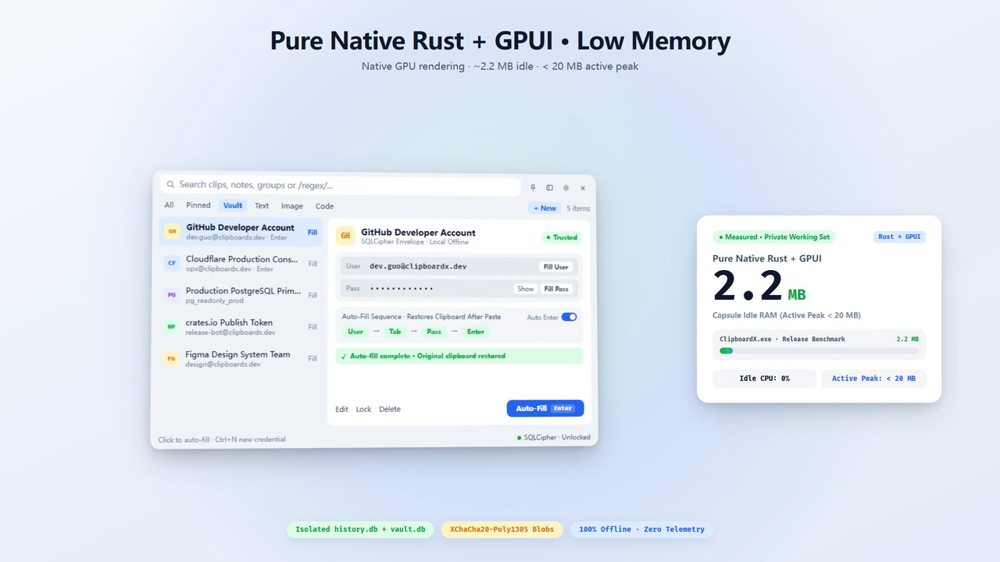
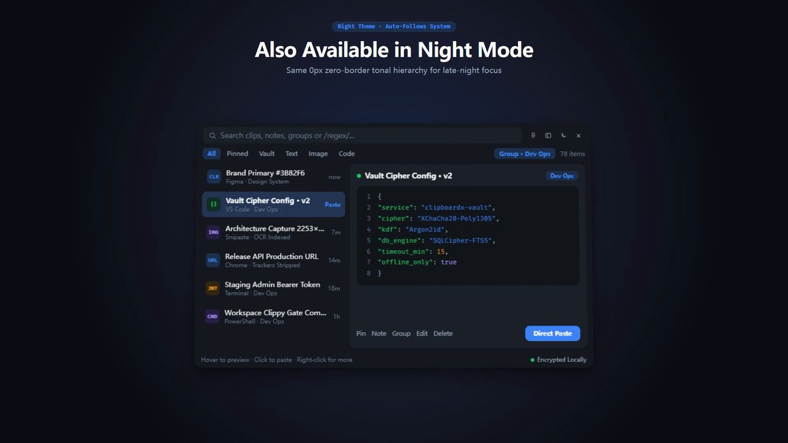

<div align="center">


# ClipboardX

[English](README.md) · [简体中文](README.zh-CN.md)

[](https://github.com/GXSZone/ClipboardX/releases/latest)
[](LICENSE-MIT)
[](https://www.rust-lang.org/)
[](https://github.com/GXSZone/ClipboardX/releases/latest)

[Download Latest Release](https://github.com/GXSZone/ClipboardX/releases/latest) · [Watch Full 50s Video (with Audio)](https://github.com/GXSZone/ClipboardX/releases/download/v0.1.0/clipboardx-promo-en-preview.mp4)

<br />


</div>

---

## Visual Showcase

| Dual-Pane Main Panel (Light) | Liquid Frosted Dock Capsule |
| :---: | :---: |
|  |  |

| Instant Search & Smart Color Preview | Image Preview & Offline Native OCR |
| :---: | :---: |
|  |  |

| Encrypted Vault & Real-World Low RAM | Night Mode Theme Included |
| :---: | :---: |
|  |  |

---

## Core Features

- **Native Rust + GPUI Low Memory Footprint**: Pure native GPU-accelerated rendering with measured Private Working Set around **2.2 MB** in standby capsule mode and **< 20 MB** peak across active multi-window interactions.
- **Floating Panel ↔ Liquid Frosted Capsule**: Automatically glides into a `38×58` edge-docked glass capsule on blur, pulses softly on every new copy, pops back on hover, and supports edge-snapping drag; press `Ctrl + \` for `180ms` dual (`680×420`) ↔ compact (`328×420`) morphing across Light and Night borderless themes.
- **Smart Hybrid Hotkey & Direct Paste**: `Alt + V` (`Cmd + Shift + V` on macOS) taps to toggle and holds to peek; click or press `Enter` to paste straight into your previous window, or hit `Ctrl + 1~9` for instant top-9 paste.
- **Sub-Millisecond Search & Smart Previews**: Combines FTS5 full-text, Chinese Pinyin, fuzzy, regex (`/pattern/`), and prefix filters (`type:image`, `app:chrome`); renders dedicated previews for code, JSON, JWT, colors (WCAG / OKLCH), cleaned URLs, and offline native OCR.
- **Dual-DB Encryption & Account Vault**: Isolated `history.db` and `vault.db` secured with SQLCipher, OS keyring envelope keys, and `XChaCha20-Poly1305` blobs; supports `User → Tab → Pass → Enter` sequential auto-fill with automatic clipboard restoration, password-manager blacklisting, and 100% offline zero-telemetry operation.

---

## Keyboard Shortcuts

| Shortcut | Action |
| :--- | :--- |
| `Alt + V` (`Cmd + Shift + V` on macOS) | Smart Hybrid summon / hide (tap to toggle, hold to peek) |
| `Ctrl + \` | `180ms` morph between `680×420` dual-pane and `328×420` compact view |
| `Ctrl + Alt + P` | Pause / resume clipboard monitoring |
| `Enter` / Left-Click | Direct paste into previous window (**Auto-Fill** in Vault) |
| `Shift + Enter` | Paste plain text (or password only in Vault) |
| `Ctrl + 1` – `Ctrl + 9` | Direct-paste item #1 – #9 immediately |
| `Esc` | Clear search query, press again to collapse to capsule/tray |

---

## Download

Pre-built binaries are available on [GitHub Releases](https://github.com/GXSZone/ClipboardX/releases/latest):

| Platform | Package |
| :--- | :--- |
| **Windows (x86_64)** | `clipboardx-windows-x86_64-setup.exe` (Installer) · `clipboardx-windows-x86_64-portable.zip` (Portable) |
| **macOS (Apple Silicon)** | `clipboardx-macos-aarch64.dmg` · `clipboardx-macos-aarch64.zip` |
| **Linux (x86_64)** | `clipboardx-linux-x86_64.AppImage` · `clipboardx-linux-x86_64.tar.gz` |

---

## Architecture

| Crate | Responsibility |
| :--- | :--- |
| `clipboardx-model` | Single source of truth for domain models, themes, layouts, shortcuts, config schema, and port traits |
| `clipboardx-core` | Business logic, content inspector, search engine, deduplication, and `.cbx` encrypted archive export/import |
| `clipboardx-storage` | SQLCipher dual-DB persistence, `XChaCha20-Poly1305` CAS blobs, thumbnails, and OS keyring integration |
| `clipboardx-platform` | Cross-platform clipboard watcher, privacy gate, dual-mode hotkey state machine, tray icon, and auto-fill |
| `clipboardx-ocr` | Native OS OCR providers and isolated child-process OCR plugin manager |
| `clipboardx-updater` | Optional Ed25519-signed and SHA-256-verified release updater |
| `clipboardx-app` | GPUI desktop application assembling shell, history, vault, settings, and theme systems |

---

## Build & Run

```bash
# Run the desktop application
cargo run -p clipboardx-app

# Run all workspace checks, linter, and tests
cargo check --workspace --all-targets
cargo clippy --workspace --all-targets -- -D warnings
cargo test --workspace
```

---

## License

Licensed under the [MIT License](LICENSE-MIT).
