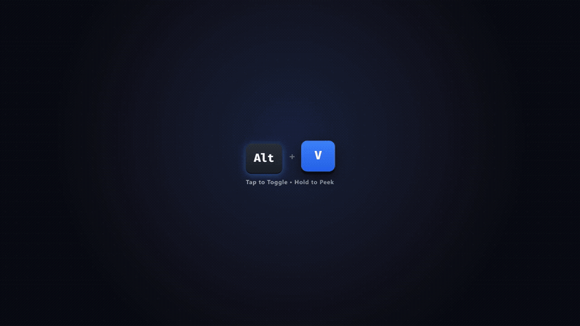
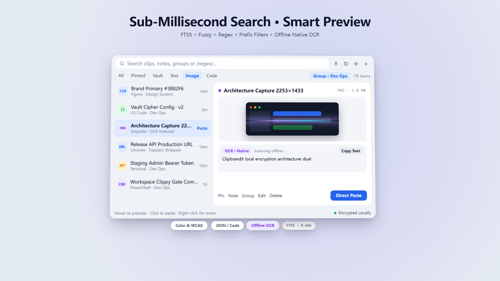
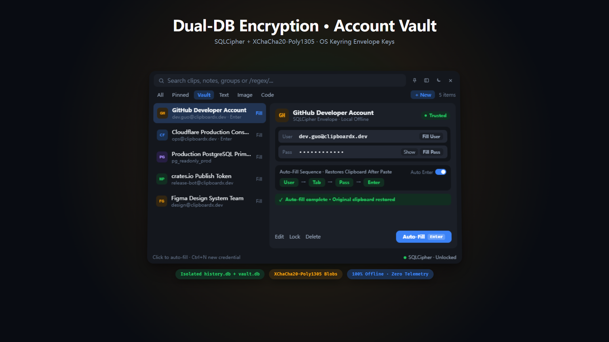

<div align="center">


# ClipboardX

**Offline-first, cross-platform clipboard manager & encrypted credential vault built with Rust + GPUI.**

English | [简体中文](README.zh-CN.md)

[](https://github.com/GXSZone/ClipboardX/releases/latest)
[](LICENSE-MIT)
[](https://www.rust-lang.org/)
[](https://github.com/GXSZone/ClipboardX/releases/latest)

[Download Latest Release](https://github.com/GXSZone/ClipboardX/releases/latest) · [Watch Full 50s Video (with Audio)](https://github.com/GXSZone/ClipboardX/releases/download/v0.1.0/clipboardx-promo-en-preview.mp4)

<br />



</div>

---

## Designed for Effortless Daily Flow

### 1. Floating Panel ↔ Liquid Frosted Dock Capsule
- **Auto-Collapse on Blur**: When you switch back to your editor or browser, the floating panel doesn't abruptly vanish—by default it glides into a `38×58` **liquid frosted glass capsule** docked cleanly to your screen edge (or optionally auto-hides to the system tray).
- **Subtle Capture Pulse**: Every time you press `Ctrl/Cmd + C` in the background, the edge capsule emits a soft luminous pulse to confirm your clip is encrypted and saved without interrupting your focus.
- **Hover Preheat & Blind-Drag Snapping**: Hover to glow and pop the panel right back open, or grab and drag the capsule vertically along the screen edge to park it anywhere out of your way.
- **`180ms` Adaptive Dual / Slim Morph**: Tap `Ctrl + \` to smoothly morph between the `680×420` dual-pane preview and the `328×420` compact single-pane list—with automatic state memory.

### 2. Smart Hybrid Hotkey & Zero-Friction Direct Paste
- **Tap to Toggle · Hold to Peek (Smart Hybrid, Default)**:
  - **Tap `< 260ms`**: Press `Alt + V` (`Cmd + Shift + V` on macOS) to keep the panel open while browsing, organizing groups, or inspecting images/OCR.
  - **Hold `≥ 260ms`**: Hold the hotkey to peek, pick an item, and release to paste & dismiss in one fluid gesture (pure Toggle and pure Hold-to-Peek modes are also available).
- **One-Click Direct Paste**: Hover to inspect rich previews (code, JSON, JWT, WCAG color swatches, cleaned URLs, images & OCR), then **single-click or press `Enter`** to restore focus to your previous app and paste instantly—no more copy → switch window → `Ctrl + V`.
- **Instant Top-9 Paste**: Press `Ctrl + 1` through `Ctrl + 9` right after summoning to direct-paste any of your latest 9 clips without touching the mouse.

### 3. Sub-Millisecond Multi-Dimensional Search
- **All-in-One Search Bar**: Combines SQLite FTS5 full-text search, Chinese Pinyin (initials & full), fuzzy matching, regex (`/pattern/`), and structured prefix filters (`type:color`, `type:image`, `type:code`, `app:chrome`).
- **Searchable Screenshots via Offline OCR**: Native OS OCR (WinRT / Vision) and optional offline plugins automatically index text inside screenshots directly into your encrypted local database.

### 4. Encrypted Account Vault & Clipboard-Safe Auto-Fill
- **Dual-Database Local Encryption**: Regular history (`history.db`) and credentials (`vault.db`) live in separate **SQLCipher** databases backed by OS keyring envelope keys and `XChaCha20-Poly1305` CAS blobs—100% offline with zero telemetry.
- **One-Click Sequential Auto-Fill**: Press `Enter` on any vault credential to auto-type `User → Tab → Password → Enter`, then automatically wipe temporary secrets and **restore your original clipboard**.
- **Proactive Privacy Gate**: Respects OS confidential clipboard flags, ignores major password managers out of the box (`1Password`, `Bitwarden`, `KeePassXC`, `Enpass`, `Keychain Access`), and lets you pause capture anytime with `Ctrl + Alt + P`.

---

## Keyboard Shortcuts

| Shortcut | Scope | Action |
| :--- | :--- | :--- |
| `Alt + V` (`Cmd + Shift + V` on macOS) | Global | Smart Hybrid summon / hide (tap to toggle, hold to peek) |
| `Ctrl + \` | Global / Panel | `180ms` morph between `680×420` dual-pane and `328×420` compact view |
| `Ctrl + Alt + P` | Global | Pause / resume clipboard monitoring on the fly |
| `Enter` / Left-Click | Panel | Direct paste into previous window (**Auto-Fill** in Account Vault) |
| `Shift + Enter` | Panel | Paste as plain text (or fill password only in Account Vault) |
| `Ctrl + 1` – `Ctrl + 9` | Panel | Direct-paste item #1 – #9 immediately |
| `↑` / `↓` | Panel | Navigate history list with live right-pane preview |
| `Esc` | Panel | Clear search query first, press again to collapse back to capsule/tray |

---

## Visual Showcase

| Dual-Pane Main Panel (Night) | Liquid Frosted Dock Capsule |
| :---: | :---: |
|  |  |

| Seamless Night & Light Themes | Instant Search & Smart Color Preview |
| :---: | :---: |
|  |  |

| Image Preview & Offline Native OCR | Encrypted Account Vault & Auto-Fill |
| :---: | :---: |
|  |  |

---

## Download

Pre-built binaries are available on [GitHub Releases](https://github.com/GXSZone/ClipboardX/releases/latest):

| Platform | Package |
| :--- | :--- |
| **Windows (x86_64)** | `clipboardx-windows-x86_64-setup.exe` (Installer) · `clipboardx-windows-x86_64-portable.zip` (Portable) |
| **macOS (Apple Silicon)** | `clipboardx-macos-aarch64.dmg` · `clipboardx-macos-aarch64.zip` |
| **Linux (x86_64)** | `clipboardx-linux-x86_64.AppImage` · `clipboardx-linux-x86_64.tar.gz` |

---

## Architecture

ClipboardX follows a strict acyclic hexagonal workspace layout:

| Crate | Responsibility |
| :--- | :--- |
| `clipboardx-model` | Single source of truth for domain models, themes, layouts, shortcuts, config schema, and port traits |
| `clipboardx-core` | Business logic, content inspector, search engine, deduplication, and `.cbx` encrypted archive export/import |
| `clipboardx-storage` | SQLCipher dual-DB persistence, `XChaCha20-Poly1305` CAS blobs, thumbnails, and OS keyring integration |
| `clipboardx-platform` | Cross-platform clipboard watcher, privacy gate, dual-mode hotkey state machine, tray icon, and auto-fill |
| `clipboardx-ocr` | Native OS OCR providers and isolated child-process OCR plugin manager |
| `clipboardx-updater` | Optional Ed25519-signed and SHA-256-verified release updater |
| `clipboardx-app` | GPUI desktop application assembling shell, history, vault, settings, and theme systems |

---

## Build & Run

### Prerequisites

- **Rust** `1.89+` (Edition 2024)
- Platform build tools (Windows MSVC Build Tools / macOS Xcode Command Line Tools / Linux GTK & X11/Wayland dev libraries)

### Commands

```bash
# Run the desktop application
cargo run -p clipboardx-app

# Run all workspace checks, linter, and tests
cargo check --workspace --all-targets
cargo clippy --workspace --all-targets -- -D warnings
cargo test --workspace
```

---

## License

Licensed under the [MIT License](LICENSE-MIT).
