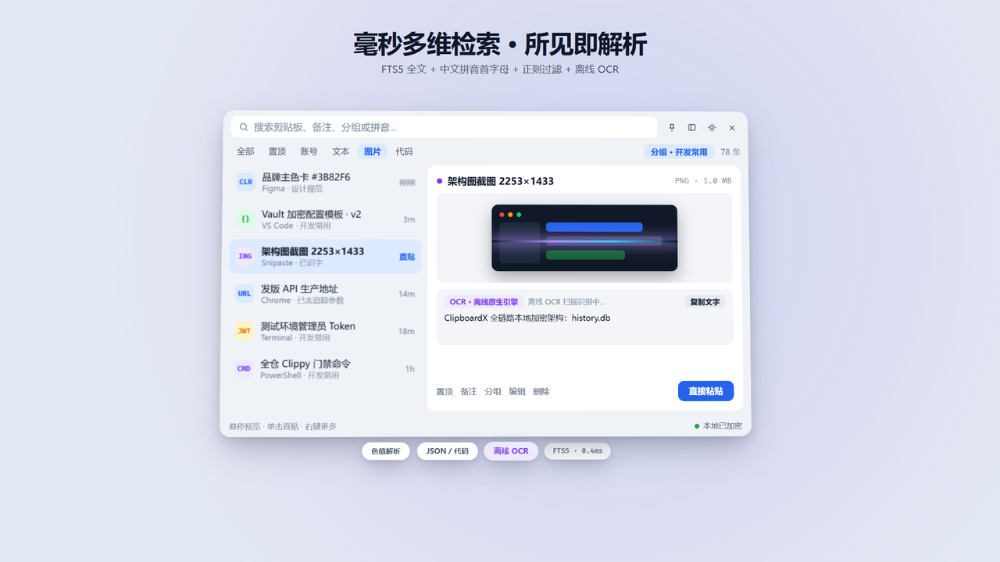

<div align="center">


# ClipboardX

**基于 Rust 与 GPUI 原生自绘打造的跨平台、纯离线剪贴板效率工具与加密账号保险箱。**

[English](README.md) | 简体中文

[](https://github.com/GXSZone/ClipboardX/releases/latest)
[](LICENSE-MIT)
[](https://www.rust-lang.org/)
[](https://github.com/GXSZone/ClipboardX/releases/latest)

[下载最新版安装包](https://github.com/GXSZone/ClipboardX/releases/latest) · [观看完整 50 秒有声宣传片](https://github.com/GXSZone/ClipboardX/releases/download/v0.1.0/clipboardx-promo-zh-preview.mp4)

<br />


</div>

---

## 界面预览

| 双栏主面板（Night 暗夜） | 光感玻璃停靠胶囊（38×58） |
| :---: | :---: |
|  |  |

| Night / Light 双模式美学切换 | 拼音极速检索与色卡 WCAG 解析 |
| :---: | :---: |
|  |  |

| 图片预览与离线 OCR 文字识别 | 双库加密账号保险箱与一键连填 |
| :---: | :---: |
|  |  |

---

## 核心特性

- **零描边色阶美学**：`680×420` 完整双栏与 `328×420` 简洁单栏悬浮窗，`180ms` 弹性侧边收缩，支持 `38×58` 光感玻璃磨砂停靠胶囊与 Night / Light 双模式主题，全界面 `0px` 描边。
- **全链路本地加密**：普通历史 `history.db` 与账号保险箱 `vault.db` 双库隔离，采用 SQLCipher 全库（含 FTS5）加密、系统密钥环信封加密与 CAS `XChaCha20-Poly1305` Blob 加密。
- **智能内容解析与预览**：自动识别代码、JSON、JWT、色值（含 WCAG 对比度与 OKLCH）、URL（支持一键去除追踪参数）、时间戳与图片，并提供专属右侧预览卡片。
- **多维毫秒级检索**：融合 FTS5 全文检索、中文拼音首字母/全拼、模糊匹配、正则（`/pattern/`）及前缀过滤（`type:color`、`type:image`、`app:editor`）。
- **账号保险箱与一键连填**：独立口令保护的账号凭证库，内置密码强度评估、CSPRNG 强密码生成，以及支持完成后自动擦除并还原原剪贴板的一键连填（`账号 → Tab → 密码 → Enter`）。
- **离线 OCR 文字识别**：支持系统原生 OCR（WinRT / Vision）与按需下载或本地导入离线插件，自动将截图文字写入加密索引。
- **零后台遥测**：100% 纯本地运行，仅在手动或开启更新检查时校验 Ed25519 签名清单。

---

## 下载安装

前往 [GitHub Releases](https://github.com/GXSZone/ClipboardX/releases/latest) 获取全平台预编译安装包：

| 平台 | 安装包 |
| :--- | :--- |
| **Windows (x86_64)** | `clipboardx-windows-x86_64-setup.exe`（安装器） · `clipboardx-windows-x86_64-portable.zip`（便携版） |
| **macOS (Apple Silicon)** | `clipboardx-macos-aarch64.dmg` · `clipboardx-macos-aarch64.zip` |
| **Linux (x86_64)** | `clipboardx-linux-x86_64.AppImage` · `clipboardx-linux-x86_64.tar.gz` |

---

## 仓库架构

项目采用严格无环的六边形 Workspace 分层结构：

| Crate | 职责 |
| :--- | :--- |
| `clipboardx-model` | 唯一事实来源（SSOT）：领域模型、主题色表、布局常量、快捷键、配置 Schema 与端口 Trait |
| `clipboardx-core` | 纯业务逻辑：内容识别、多维检索、去重淘汰与 `.cbx` 加密归档导入导出 |
| `clipboardx-storage` | 加密持久化：SQLCipher 双库、CAS `XChaCha20-Poly1305` 存储、缩略图缓存与系统密钥环 |
| `clipboardx-platform` | 跨平台原生桥：剪贴板监听、隐私门禁、双模热键状态机、系统托盘与模拟连填 |
| `clipboardx-ocr` | OCR 适配层：系统原生识别与子进程沙箱化离线插件管理 |
| `clipboardx-updater` | 可选更新器：Ed25519 验签与 SHA-256 校验 |
| `clipboardx-app` | GPUI 桌面应用：悬浮窗壳层、历史列表、账号保险箱、设置中心与主题动效 |

---

## 构建与运行

### 环境要求

- **Rust** `1.89+`（2024 Edition）
- 对应平台编译工具链（Windows MSVC Build Tools / macOS Xcode Command Line Tools / Linux 开发依赖库）

### 常用命令

```bash
# 启动桌面应用
cargo run -p clipboardx-app

# 运行全仓编译检查、Clippy 门禁与单元测试
cargo check --workspace --all-targets
cargo clippy --workspace --all-targets -- -D warnings
cargo test --workspace
```

---

## 开源协议

基于 [MIT License](LICENSE-MIT) 开源。
