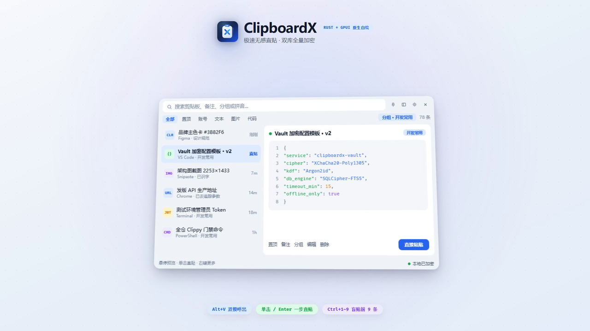
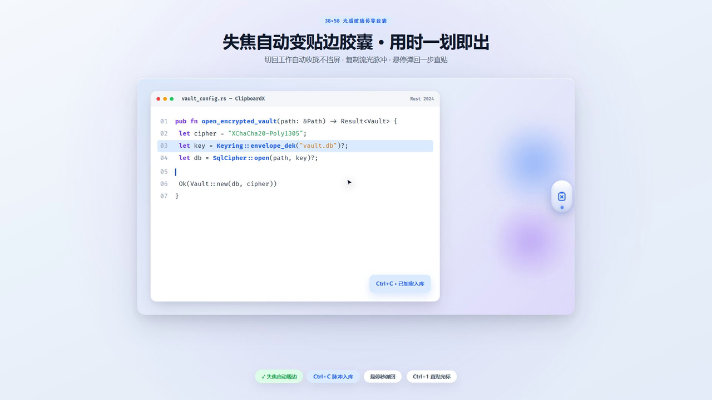
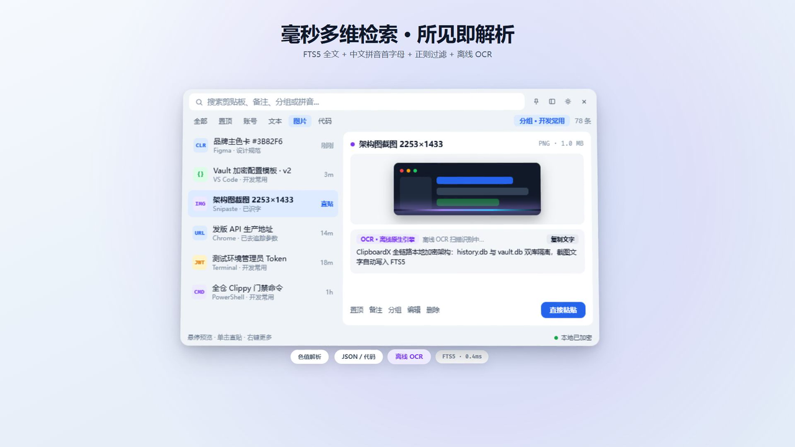
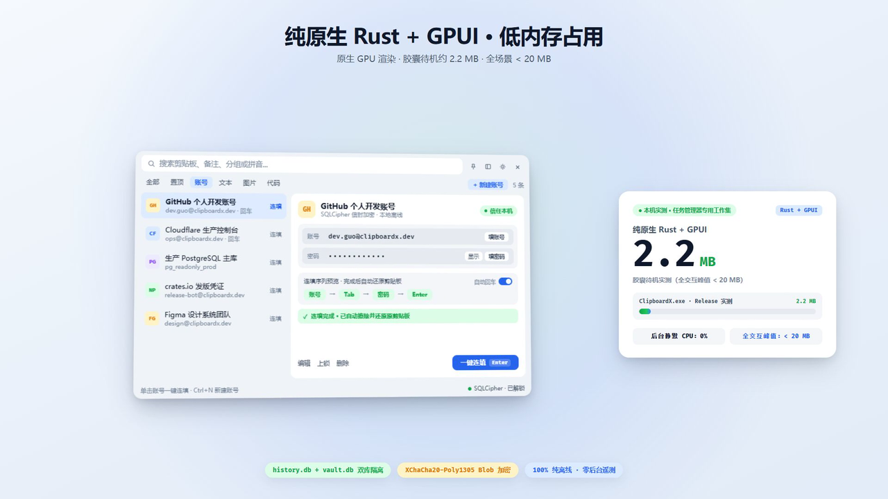
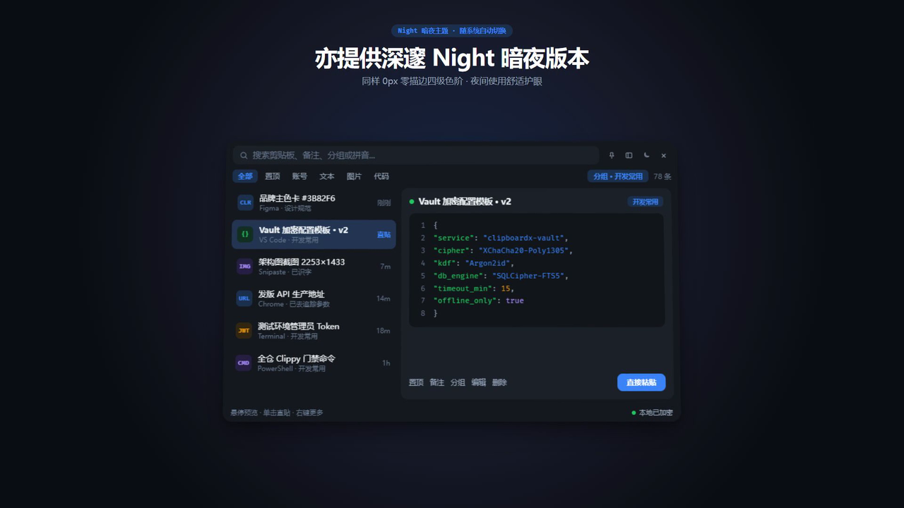

<div align="center">


# ClipboardX

[English](README.md) · 简体中文

[](https://github.com/GXSZone/ClipboardX/releases/latest)
[](LICENSE-MIT)
[](https://www.rust-lang.org/)
[](https://github.com/GXSZone/ClipboardX/releases/latest)

[下载最新版安装包](https://github.com/GXSZone/ClipboardX/releases/latest) · [观看完整 50 秒有声宣传片](https://github.com/GXSZone/ClipboardX/releases/download/v0.1.0/clipboardx-promo-zh-preview.mp4)

<br />


</div>

---

## 界面预览

| 双栏主面板（Light 洁白） | 冰雾白贴边胶囊（38×58） |
| :---: | :---: |
|  |  |

| 拼音极速检索与色卡 WCAG 解析 | 图片预览与离线 OCR 文字识别 |
| :---: | :---: |
|  |  |

| 加密保险箱与实测低内存占用 | 同步内置 Night 暗夜模式 |
| :---: | :---: |
|  |  |

---

## 核心特性

- **纯原生的 Rust + GPUI 低内存占用**：原生 GPU 自绘渲染，本机实测待机胶囊态专用工作集约 **2.2 MB**，全场景交互（图片悬停弹窗、设置中心、OCR）峰值 **< 20 MB**。
- **悬浮窗 ↔ 贴边光感玻璃胶囊**：失焦自动收拢为屏幕边缘 `38×58` 冰雾白磨砂胶囊，复制新内容时蓝绿流光脉冲提示，悬停即弹回、支持盲拖吸边；`Ctrl + \` 可在 `680×420` 双栏与 `328×420` 单栏间 `180ms` 弹性切换，支持 Light 与 Night 无边框双主题。
- **双模热键与一步直贴**：`Alt + V`（macOS `Cmd + Shift + V`）短按常驻、长按松手即收；单击 / `Enter` 无感直贴原窗口，`Ctrl + 1~9` 极速盲贴前 9 条。
- **多维毫秒检索与智能预览**：融合 FTS5 全文、中文拼音首字母/全拼、模糊与正则（`/pattern/`）及前缀过滤（`type:image`、`app:chrome`）；自动解析代码、JSON、JWT、色值（WCAG / OKLCH）、URL（去追踪参数）与图片离线 OCR。
- **双库全量加密与账号保险箱**：`history.db` 与 `vault.db` 双库隔离，SQLCipher + 系统密钥环信封加密 + `XChaCha20-Poly1305` Blob 加密；支持 `账号 → Tab → 密码 → Enter` 一键连填并自动还原原剪贴板，内置密码管理器黑名单，100% 纯离线零遥测。

---

## 快捷键速查

| 快捷键 | 功能说明 |
| :--- | :--- |
| `Alt + V`（macOS：`Cmd + Shift + V`） | 智能双模呼出 / 收起（短按常驻，长按松手即收） |
| `Ctrl + \` | `180ms` 切换 `680×420` 双栏 ↔ `328×420` 简洁单栏 |
| `Ctrl + Alt + P` | 一键暂停 / 恢复剪贴板监听 |
| `Enter` / 左键单击 | 直接粘贴到原窗口（保险箱页为**一键连填**） |
| `Shift + Enter` | 纯文本粘贴（保险箱页为仅填密码） |
| `Ctrl + 1` ~ `Ctrl + 9` | 极速直贴第 1 ~ 9 条记录 |
| `Esc` | 清空搜索词，再按一次收起回到贴边胶囊或托盘 |

---

## 下载安装

前往 [GitHub Releases](https://github.com/GXSZone/ClipboardX/releases/latest) 获取全平台预编译安装包：

| 平台 | 安装包 |
| :--- | :--- |
| **Windows (x86_64)** | `clipboardx-windows-x86_64-setup.exe`（安装器） · `clipboardx-windows-x86_64-portable.zip`（便携版） |
| **macOS (Apple Silicon)** | `clipboardx-macos-aarch64.dmg` · `clipboardx-macos-aarch64.zip` |
| **Linux (x86_64)** | `clipboardx-linux-x86_64.AppImage` · `clipboardx-linux-x86_64.tar.gz` |

---

## 仓库架构

| Crate | 职责 |
| :--- | :--- |
| `clipboardx-model` | 唯一事实来源（SSOT）：领域模型、主题色表、布局常量、快捷键、配置 Schema 与端口 Trait |
| `clipboardx-core` | 纯业务逻辑：内容识别、多维检索、去重淘汰与 `.cbx` 加密归档导入导出 |
| `clipboardx-storage` | 加密持久化：SQLCipher 双库、CAS `XChaCha20-Poly1305` 存储、缩略图缓存与系统密钥环 |
| `clipboardx-platform` | 跨平台原生桥：剪贴板监听、隐私门禁、双模热键状态机、系统托盘与模拟连填 |
| `clipboardx-ocr` | OCR 适配层：系统原生识别与子进程沙箱化离线插件管理 |
| `clipboardx-updater` | 可选更新器：Ed25519 验签与 SHA-256 校验 |
| `clipboardx-app` | GPUI 桌面应用：悬浮窗壳层、历史列表、账号保险箱、设置中心与主题动效 |

---

## 构建与运行

```bash
# 启动桌面应用
cargo run -p clipboardx-app

# 运行全仓编译检查、Clippy 门禁与单元测试
cargo check --workspace --all-targets
cargo clippy --workspace --all-targets -- -D warnings
cargo test --workspace
```

---

## 开源协议

基于 [MIT License](LICENSE-MIT) 开源。
