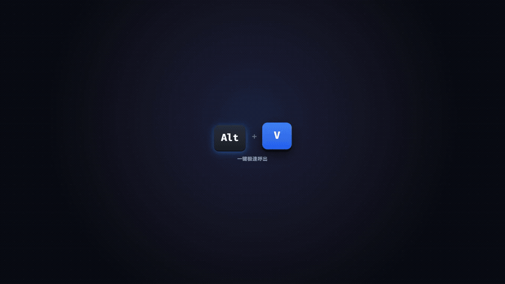
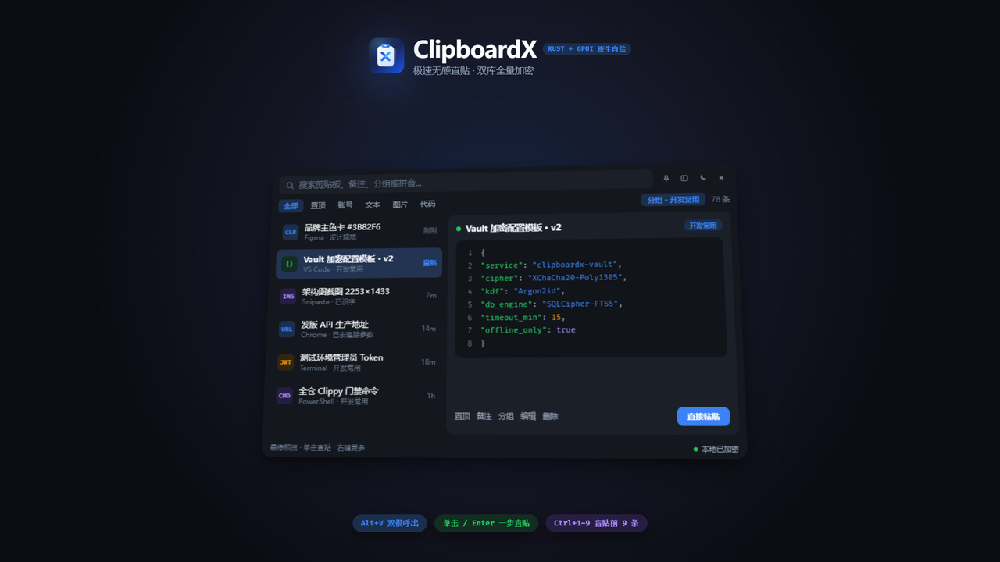
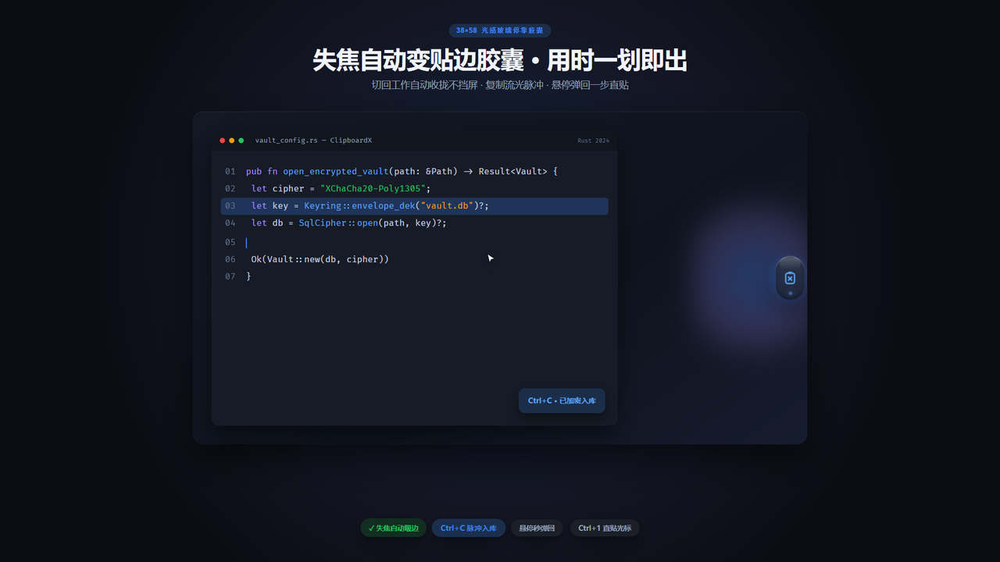
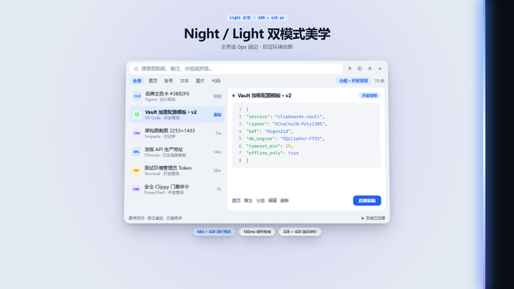
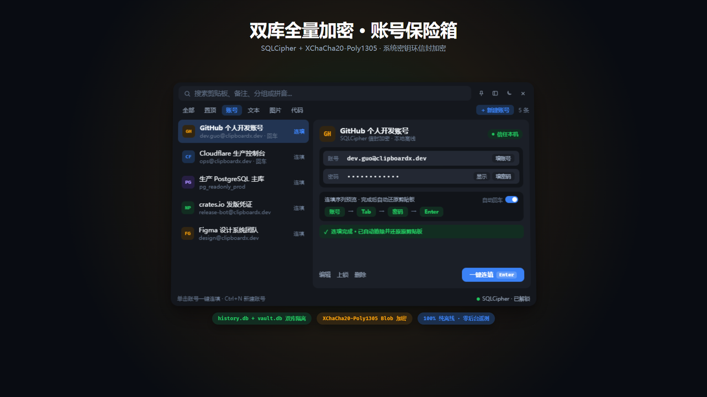

<div align="center">


# ClipboardX

**基于 Rust 与 GPUI 原生自绘打造的跨平台、纯离线剪贴板效率工具与加密账号保险箱。**

[English](README.md) | 简体中文

[](https://github.com/GXSZone/ClipboardX/releases/latest)
[](LICENSE-MIT)
[](https://www.rust-lang.org/)
[](https://github.com/GXSZone/ClipboardX/releases/latest)

[下载最新版安装包](https://github.com/GXSZone/ClipboardX/releases/latest) · [观看完整 50 秒有声宣传片](https://github.com/GXSZone/ClipboardX/releases/download/v0.1.0/clipboardx-promo-zh-preview.mp4)

<br />



</div>

---

## 为什么用起来顺手？

### 1. 悬浮窗 ↔ 贴边光感玻璃胶囊，招之即来、挥之即收
- **失焦自动缩成迷你胶囊**：切回编辑器或浏览器继续工作时，悬浮窗默认不会生硬消失，而是柔和收拢为停靠在屏幕边缘的 `38×58` **光感玻璃磨砂胶囊**，不挡视野、随时待命（也可在设置中切换为失焦隐藏到系统托盘）。
- **新复制流光脉冲反馈**：后台按下 `Ctrl + C` 复制内容时，贴边胶囊会自动泛起一圈柔和的蓝绿流光脉冲，无弹窗打扰却清晰确认“已加密入库”。
- **悬停预热 + 盲拖吸边**：鼠标靠近胶囊即刻提亮微晕并一键唤回主面板；按住胶囊即可上下盲拖并自动吸附屏幕边缘，想停哪就停哪。
- **双形态 `180ms` 弹性伸缩**：按下 `Ctrl + \`，面板在 `680×420` 完整双栏预览与 `328×420` 简洁单栏之间丝滑伸缩，并自动记忆你偏好的展开态。

### 2. 智能双模热键 & 无感直贴流
- **短按常驻 · 长按即看即走（Smart Hybrid，默认）**：
  - **短按 `< 260ms`**：按一下 `Alt + V`（macOS 为 `Cmd + Shift + V`）呼出面板常驻，适合慢慢翻找、管理分组、看图或提取 OCR 文字。
  - **长按 `≥ 260ms`**：按住热键呼出 → 选好条目松手即自动粘贴并收起，行云流水零停顿（同样支持切换为纯 Toggle 或纯按住预览模式）。
- **真·一步直贴原窗口**：鼠标悬停即可在右侧预览全文、代码、色值或图片，**左键单击（或按 `Enter`）** 立即写回剪贴板并自动恢复原焦点窗口完成粘贴，免去“点击复制 → 切窗 → `Ctrl + V`”的三步繁琐。
- **盲贴前 9 条**：面板呼出后直接按 `Ctrl + 1` ~ `Ctrl + 9`，瞬间把最近第 1~9 条内容直贴到光标处。

### 3. 一行搜索框搞定多维毫秒定位
- **中文拼音直搜**：无需切输入法，直接输入拼音首字母或全拼（如 `seka`、`mima`、`kaifa`），毫秒级命中中文历史、备注与分组。
- **结构化前缀与正则**：支持 `type:image`、`type:color`、`type:code`、`app:chrome` 等前缀精准筛选，也支持 `/pattern/` 正则检索代码片段与日志。
- **截图文字自动可搜**：系统原生离线 OCR（WinRT / Vision）与可选离线插件会自动把截图中的文字写入加密 FTS5 索引，搜图就像搜文字一样快。

### 4. 加密账号保险箱 · 一键连填自动复原
- **双库物理隔离加密**：普通剪贴历史（`history.db`）与敏感账号凭证（`vault.db`）独立存储，采用 **SQLCipher 全库加密 + 系统密钥环信封加密 + `XChaCha20-Poly1305` Blob 加密**，100% 纯本地零遥测。
- **一键顺序连填并还原剪贴板**：在账号页按 `Enter`（或点击条目），自动模拟 `账号 → Tab → 密码 → Enter` 顺序填入登录框；完成后自动擦除临时密码并**还原你原本的剪贴板内容**。
- **主动隐私门禁**：自动忽略系统机密剪贴板标记，内置密码管理器黑名单（默认忽略 `1Password`、`Bitwarden`、`KeePassXC`、`Enpass`、`Keychain Access`），随时按 `Ctrl + Alt + P` 临时暂停监听。

---

## 快捷键速查

| 快捷键 | 作用域 | 功能说明 |
| :--- | :--- | :--- |
| `Alt + V`（macOS：`Cmd + Shift + V`） | 全局 | 智能双模呼出 / 收起主面板（短按常驻，长按松手即收） |
| `Ctrl + \` | 全局 / 面板内 | `180ms` 弹性切换 `680×420` 完整双栏 ↔ `328×420` 简洁单栏 |
| `Ctrl + Alt + P` | 全局 | 一键暂停 / 恢复剪贴板监听（临时复制敏感内容不入库） |
| `Enter` / 左键单击 | 面板内 | 直接粘贴到原焦点窗口（保险箱页为**一键连填**） |
| `Shift + Enter` | 面板内 | 纯文本无格式粘贴（保险箱页为仅填入密码） |
| `Ctrl + 1` ~ `Ctrl + 9` | 面板内 | 极速直贴列表中第 1 ~ 9 条记录 |
| `↑` / `↓` | 面板内 | 上下切换选中条目并实时更新右侧预览卡片 |
| `Esc` | 面板内 | 先清空搜索关键词，再次按下收起面板（回到贴边胶囊或托盘） |

---

## 界面预览

| 双栏主面板（Night 暗夜） | 光感玻璃停靠胶囊（38×58） |
| :---: | :---: |
|  |  |

| Night / Light 双模式美学切换 | 拼音极速检索与色卡 WCAG 解析 |
| :---: | :---: |
|  |  |

| 图片预览与离线 OCR 文字识别 | 双库加密账号保险箱与一键连填 |
| :---: | :---: |
|  |  |

---

## 下载安装

前往 [GitHub Releases](https://github.com/GXSZone/ClipboardX/releases/latest) 获取全平台预编译安装包：

| 平台 | 安装包 |
| :--- | :--- |
| **Windows (x86_64)** | `clipboardx-windows-x86_64-setup.exe`（安装器） · `clipboardx-windows-x86_64-portable.zip`（便携版） |
| **macOS (Apple Silicon)** | `clipboardx-macos-aarch64.dmg` · `clipboardx-macos-aarch64.zip` |
| **Linux (x86_64)** | `clipboardx-linux-x86_64.AppImage` · `clipboardx-linux-x86_64.tar.gz` |

---

## 仓库架构

项目采用严格无环的六边形 Workspace 分层结构：

| Crate | 职责 |
| :--- | :--- |
| `clipboardx-model` | 唯一事实来源（SSOT）：领域模型、主题色表、布局常量、快捷键、配置 Schema 与端口 Trait |
| `clipboardx-core` | 纯业务逻辑：内容识别、多维检索、去重淘汰与 `.cbx` 加密归档导入导出 |
| `clipboardx-storage` | 加密持久化：SQLCipher 双库、CAS `XChaCha20-Poly1305` 存储、缩略图缓存与系统密钥环 |
| `clipboardx-platform` | 跨平台原生桥：剪贴板监听、隐私门禁、双模热键状态机、系统托盘与模拟连填 |
| `clipboardx-ocr` | OCR 适配层：系统原生识别与子进程沙箱化离线插件管理 |
| `clipboardx-updater` | 可选更新器：Ed25519 验签与 SHA-256 校验 |
| `clipboardx-app` | GPUI 桌面应用：悬浮窗壳层、历史列表、账号保险箱、设置中心与主题动效 |

---

## 构建与运行

### 环境要求

- **Rust** `1.89+`（2024 Edition）
- 对应平台编译工具链（Windows MSVC Build Tools / macOS Xcode Command Line Tools / Linux 开发依赖库）

### 常用命令

```bash
# 启动桌面应用
cargo run -p clipboardx-app

# 运行全仓编译检查、Clippy 门禁与单元测试
cargo check --workspace --all-targets
cargo clippy --workspace --all-targets -- -D warnings
cargo test --workspace
```

---

## 开源协议

基于 [MIT License](LICENSE-MIT) 开源。
